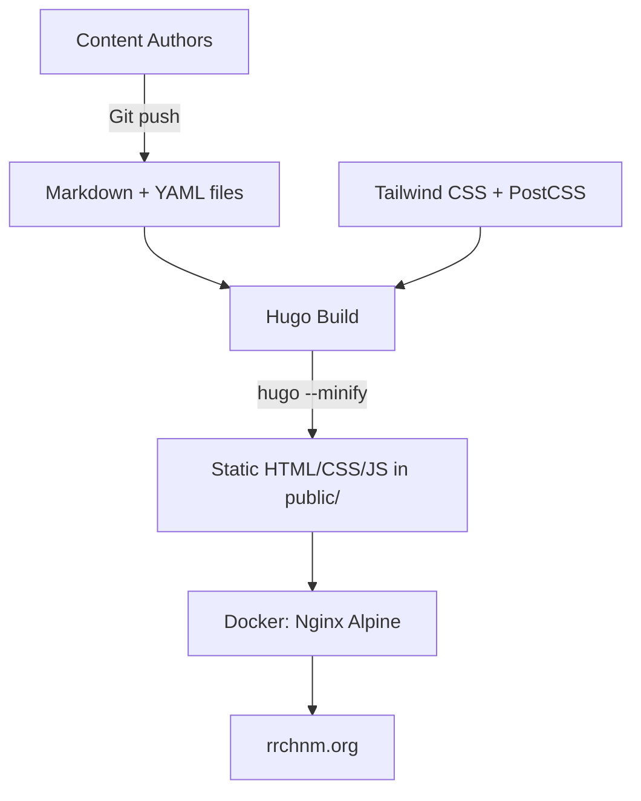

# AGENTS.md

> For feature specifications, business rules, and domain models, see [SPEC.md](./SPEC.md).

---

## Table of Contents

- [Project Overview](#project-overview)
- [Tech Stack](#tech-stack)
- [Project Initialization](#project-initialization)
- [Project Structure](#project-structure)
- [Architecture](#architecture)
- [Development Workflow](#development-workflow)
- [Best Practices & Key Conventions](#best-practices--key-conventions)
- [Notes for AI Agents](#notes-for-ai-agents)

---

## Project Overview

Public website for the Roy Rosenzweig Center for History and New Media (RRCHNM) at George Mason University. A Hugo static site currently being redesigned with Tailwind CSS. The site showcases the center's projects, publications, blog, people, and graduate education programs.

---

## Tech Stack

### Package Management

- **npm** for Node.js dependencies
- Node.js required for PostCSS/Tailwind build pipeline
- `npm ci` for reproducible installs (used in CI and Docker)
- Key scripts:
  - `npm run dev` → `hugo server` (local dev with live reload)
  - `npm run build` → `hugo --minify` (production build)

### Frontend

- **Hugo 0.154.5 Extended** — static site generator (Extended version required for CSS processing)
- **Tailwind CSS 3.4** — utility-first CSS framework
- **PostCSS** with autoprefixer
- **Alpine.js** — lightweight JS for interactive components (project filtering, staff modals)
- **@tailwindcss/typography** — prose styling plugin
- No build bundler (Vite, Webpack, etc.) — Hugo's asset pipeline handles everything

### Database

None. All content is Markdown files with YAML frontmatter. Data-driven content uses YAML files in `data/`.

---

## Project Initialization

**Prerequisites:**
- Hugo Extended 0.154.5+ ([install guide](https://gohugo.io/installation/))
- Node.js and npm

**Setup:**
```bash
git clone <repo-url>
cd rrchnm.org
npm ci
npm run dev
```

The dev server runs at `http://localhost:1313/` with live reload.

---

## Project Structure

```
rrchnm.org/
├── assets/
│   ├── css/main.css          # Tailwind entry point (@layer base/components/utilities)
│   └── js/                   # JavaScript modules
├── content/
│   ├── blog/                 # Blog posts (Markdown + YAML frontmatter)
│   ├── projects/             # Project pages
│   ├── publications/         # Publication entries
│   └── page/                 # Static pages (about, contact, etc.)
├── data/
│   ├── menus.yaml            # Navigation menus (top_nav, mobile_nav, footer)
│   ├── people.yaml           # Staff directory
│   └── footer.yaml           # Footer configuration
├── layouts/
│   ├── _default/             # Base templates (baseof, list, single)
│   ├── blog/                 # Blog templates
│   ├── projects/             # Project templates
│   ├── publications/         # Publication templates
│   ├── page/                 # Custom page templates (our-work, our-people, contact, etc.)
│   ├── partials/             # Reusable template fragments
│   ├── shortcodes/           # Custom Hugo shortcodes
│   ├── tags/                 # Tag taxonomy templates
│   └── index.html            # Homepage
├── static/
│   ├── media/                # Uploaded images and media
│   ├── img/                  # Icons and site images
│   └── _redirects            # URL redirect rules
├── scripts/                  # Python utilities (project crawling, frontmatter cleanup)
├── hugo.yaml                 # Hugo site configuration
├── tailwind.config.js        # Tailwind theme (colors, fonts, typography)
├── postcss.config.js         # PostCSS plugins (tailwindcss, autoprefixer)
├── Dockerfile                # Multi-stage: Hugo build → Nginx serving
└── package.json              # Node.js dependencies and scripts
```

---

## Architecture

### System Architecture Diagram



### Build Pipeline

1. Content is authored as Markdown files with YAML frontmatter in `content/`
2. Data files in `data/` provide structured content (menus, people)
3. Hugo templates in `layouts/` render content into HTML
4. Tailwind CSS is processed via PostCSS during Hugo's asset pipeline
5. `hugo --minify` produces optimized static files in `public/`
6. Docker packages the output into an Nginx container
7. GitHub Actions CI/CD builds and deploys on push to `main` or `preview`

### Template Hierarchy

Hugo resolves templates by section and type:
- `/blog/post-slug/` → `layouts/blog/single.html`
- `/blog/` → `layouts/blog/list.html`
- `/our-work/` → `layouts/page/our-work.html` (custom page layout)
- `/people/` → `layouts/page/our-people.html`
- Homepage → `layouts/index.html`
- Fallback → `layouts/_default/single.html` or `list.html`

### Key Interactive Components

- **Project filtering** (`layouts/page/our-work.html`): Alpine.js-driven category filter buttons that show/hide project cards client-side
- **Staff modal** (`layouts/page/our-people.html`): HTML `<dialog>` element with Alpine.js for staff profile popups
- **Site search**: Cmd-K / Ctrl-K shortcut opens search modal; uses Hugo's JSON output as a client-side search index

---

## Development Workflow

### Version Control

- **Main branch:** `main` (production deployments)
- **Preview branch:** `preview` (staging deployments)
- **Active branch:** `tailwind-redesign` (current redesign work)
- CI/CD triggers on pushes to `main` and `preview`

### Serving the Application

**Development:**
```bash
npm run dev          # Hugo server at localhost:1313 with live reload
```

**Production build:**
```bash
npm run build        # hugo --minify → outputs to public/
```

**Docker build:**
```bash
docker build -t rrchnm-website .
```
The Dockerfile runs a multi-stage build: Hugo Extended on Alpine builds the site, then copies `public/` to Nginx Alpine. A symlink `/img → /assets/img` maintains backward compatibility for old image paths.

### CI/CD

GitHub Actions workflow (`.github/workflows/cicd.yml`):
- Uses reusable workflows from the `chnm/.github` org repository
- Builds Hugo site, creates Docker image, pushes to `ghcr.io`
- Deploys to `hugo.rrchnm.org`
- Release tags use ISO date format (YYYY-MM-DD)

---

## Best Practices & Key Conventions

### Styling
- Use Tailwind utility classes in templates; avoid inline styles
- Custom component styles go in `assets/css/main.css` under `@layer components`
- Brand colors: `red-brand` (#C32A26), `red-dark` (#9E2220)
- Fonts: IBM Plex Serif (headings), IBM Plex Sans (body), IBM Plex Mono (code)
- Max content width: `max-w-site` (1200px)
- Use the `.label` class for metadata labels (dates, categories, taglines)
- Use `.prose` class (from Typography plugin) for long-form Markdown content

### Templates
- Shared UI goes in `layouts/partials/`
- Custom page layouts go in `layouts/page/` and are matched by filename to `content/page/` slugs
- Use `[x-cloak]` attribute on Alpine.js elements to prevent flash of unstyled content

### Content
- Blog frontmatter: `title`, `date`, `slug`, `author_name`, `categories`, `draft`
- Project frontmatter: `title`, `categories`, `featured_image`, `project_url`, `funders`, `gallery`, `featured_project`
- Publication frontmatter: `title`, `pub_date`, `essay_author`, `essay_date`, `essay_publication_info`
- Set `draft: true` to exclude content from production builds
- Images go in `static/media/` organized by year/month

### Accessibility
- WCAG 2.1 AA target
- Focus-visible indicators use `outline-red-brand` with `outline-offset-2`
- All decorative images use empty `alt=""` and `aria-hidden="true"`
- Interactive elements use `aria-label` where visible text is insufficient

---

## Notes for AI Agents

### Important Context
- The site is mid-redesign on the `tailwind-redesign` branch — the Tailwind approach is the current direction, not legacy code
- Goldmark renderer has `unsafe: true` enabled, so raw HTML in Markdown is intentional and expected
- Homepage has Lorem ipsum placeholder text that will be replaced with final editorial copy
- The `static/_redirects` file handles URL redirects (likely for Netlify-style hosting or similar)
- Docker build creates a symlink `/img → /assets/img` for backward compatibility with old WordPress image paths

### When Making Changes
- Run `npm run dev` to verify changes render correctly
- Hugo templates use Go template syntax (`{{ }}`) — not Jinja, Handlebars, etc.
- Tailwind classes are purged based on `content` paths in `tailwind.config.js` — if adding templates in new directories, update the content array
- The `data/menus.yaml` file drives all navigation — don't hardcode nav links in templates
- Staff data lives in `data/people.yaml`, not in content files

### What to Avoid
- Don't add JavaScript frameworks beyond Alpine.js — keep the JS footprint minimal
- Don't use Hugo's built-in menu system — the site uses `data/menus.yaml` instead
- Don't put styles outside of Tailwind utilities or `@layer` directives in `main.css` (exception: JS-generated DOM that Tailwind can't purge, like search results)
- Don't change `hugo.yaml` `baseURL` for local development — Hugo server handles this automatically

---
*Last Updated: 2026-03-26*
*This document is maintained for AI agent context and onboarding.*
