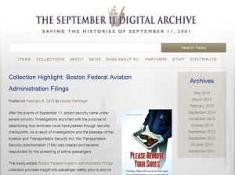

---
authors:
- "Sheila Brennan"
categories:
- News
date: '2016-09-08T11:04:17Z'
draft: false
slug: collections-continue-to-grow-in-september-11th-digital-archive
title: Collections Continue to Grow in September 11th Digital Archive
featured_image: 911-collectionhighlight-300x223.jpg
---

The fifteenth anniversary of the attacks on September 11, 2001 is upon us. We see that the legacy of those events continues to live on in current political debates, foreign and domestic policy-making, as well as for the families who lost loved ones on that day and in the conflicts that followed.
We at RRCHNM continue to expand the resources in the [September 11 Digital Archive](http://911digitalarchive.org) (911DA) as individuals and institutions want to share their collections with us. For example, retired Federal Aviation Administration employee Brian Sullivan donated a collection that offers insight into passenger safety prior to and on September 11, 2001 in the form of reports, guides, testimonies of Federal Aviation Administration employees and airport workers, meeting minutes, memos, transcripts, and affidavits. Graduate student Alyssa Fahringer scanned and described the items in the [Boston Federal Aviation Administration Filings](http://911digitalarchive.org/collections/show/293) collection.  The Center also recently received digital scans of visitor comment cards contributed at the [Smithsonian National Museum of American History](http://americanhistory.si.edu) on the 10th anniversary of 9/11 in 2011. Alyssa is adding those items this fall.
As RRCHNM continues to maintain and add collections, we are also working to improve computational access to these 150,000 digital items. With support from the Institute of Museum and Library Services, the [Omeka team is developing plugins](http://omeka.org/blog/2014/09/29/imls-funds-opening-omeka-for-close-and-distant-reading/) that will help users to mine the texts available in the site, and others like it build in [*Omeka*](http://omeka.org).
Individual items contributed to *911DA* have rich personal stories to tell that call for a close reading of the text or examination of contributed images. In some cases, a more powerful story emerges by examining the aggregate, with the promise of surfacing larger insights through “distant reading,” an analytical procedure by which researchers evaluate large bodies of text in the aggregate as a way to discern otherwise opaque patterns and meanings. To enable both close and distant reading, simple annotation and word analysis plugins are in development. The *Omeka* team will use the vast collections of *911DA* as a case study to demonstrate the benefits of using the new plugins and to publish new insights found in this corpus of materials.
Anniversaries offer time for us to reflect and think back on events from the past, and we again ask for you, your family members, your students to share [how your life has changed since September 11, 2001](http://911digitalarchive.org/contribution). If you recently visited the September 11th Memorials in New York, the Pentagon, or Shanksville we want to hear about your experiences. By collecting reflections at this commemorative moment, we hope to further the life of the *September 11th Digital Archive* as one that not only includes the most immediate reactions to the attacks, but also shows change over time as individuals reflect at different points in the post-9/11 world.
