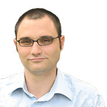

---
authors:
- "Sheila Brennan"
categories:
- News
date: '2016-10-11T10:46:36Z'
draft: false
slug: meet-the-gerda-henkel-postdoctoral-fellow-for-digital-history
title: Meet the Gerda Henkel Postdoctoral Fellow for Digital History
featured_image: toth.jpg
---

In early September, the German Historical Institute, Washington, DC and the Roy Rosenzweig Center for History and New Media welcomed Gabor M. Toth, Assistant Professor at the University of Passau, as the first Gerda Henkel postdoctoral fellow in digital history. This fellowship is intended to support junior scholars working in the field of digital history.
Prior to arriving in the US, Toth was a visiting fellow of the Oxford Research Centre in the Humanities. He completed his PhD at the University of Oxford in 2014 specializing in the history of the Italian Renaissance.
During this academic year, Toth will be using computational linguistics and text mining techniques to analyze oral history transcriptions of Holocaust survivors. He wants to explore the memory of the Holocaust by investigating heterogeneity and homogeneity in the interview data, while attempting to answer questions about the ways memory changes over time, and how gender and age shapes recollections in oral histories.  Importantly, he will look for recurrent linguistic patterns in the ways people remember and speak about trauma and persecution.
For those interested in applying for a Henkel Postdoctoral Fellowship for 2016-17, applications are now open: [http://www.ghi-dc.org/fellowships-programs/fellowships-grants/gerda-henkel-postdoctoral-fellowship-for-digital-history.html.](http://www.ghi-dc.org/fellowships-programs/fellowships-grants/gerda-henkel-postdoctoral-fellowship-for-digital-history.html)
