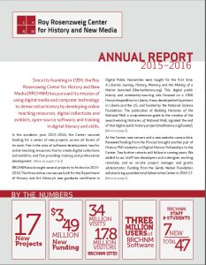

---
authors:
- "Stephen Robertson"
categories:
- news
date: '2016-11-14T10:45:37Z'
draft: false
slug: annual-report-2015-2016
title: Annual Report 2015-2016
featured_image: RRCHNM_AR-233x300.jpg
---

To keep friends and supporters of RRCHNM better informed about our ongoing work, this year we inaugurated a short annual report. Produced in collaboration with the Development Office of College of Humanities and Social Sciences, the report was mailed out in late October.
The annual report describes project launches and grants for new projects in the academic year 2015-2016. In it you can find brief descriptions of five of those new projects, and of a busy year of teaching, training, and professional development. The last year also saw a new website, new servers, and a new postdoctoral fellowship. A report on the Center's endowment completes the document.
A copy can be downloaded [here](CHNM-AR2016-100716.pdf).
