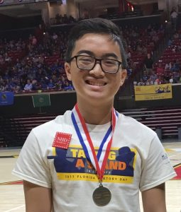
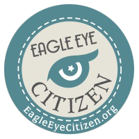

What happens when you combine more than 3,000 students who love history with an online challenge-making contest using primary sources from the Library of Congress and then sweeten the pot with a $50 Amazon gift card? That is what we wanted to find out at the National History Day® (NHD) Contest held June 11-June 15, 2017, at University of Maryland, College Park.
During the NHD Contest, RRCHNM held a challenge-making contest for [Eagle Eye Citizen](http://eagleeyecitizen.org), a new interactive website that uses primary sources from the Library of Congress to help develop students’ civic understanding and historical thinking skills. The contest created a buzz among students and teachers who love history and invited students to create challenges before the upcoming project launch.
Students from all 50 states, plus the District of Columbia, American Samoa, Guam, Puerto Rico, China, Korea, and South Asia came to this year’s contest. Each year, more than half a million students create historical research projects in one of five categories: documentaries, exhibits, papers, performances, or websites.
[caption id="attachment\_5467" align="alignright" width="255"] Kyle Nguyen, a rising junior from Palm Harbor University High, Florida won the Eagle Eye Citizen challenge making contest at NHD.[/caption]
A panel of NHD judges reviewed each Eagle Eye Citizen challenge entry and selected Kyle Nguyen, a rising junior from Palm Harbor University High, Florida, as the winner of the Amazon gift card. Kyle created the challenge, *Breaking Free*, that invites users to decide whether selected primary sources represent the 1st or the 13th Amendment. Sources included a copy of the [Bill of Rights](https://www.loc.gov/item/rbpe.24404400/), an 1866 piece of sheet music titled “[Protect the Freedman](https://www.loc.gov/item/ihas.200002239/),” an 1840 broadside for “[Friends of Harrison and Reform](https://www.loc.gov/item/2008661356/),” and a pie chart showing the [composition of church membership](https://www.loc.gov/item/07019233/) from the 1890 census. Kyle’s success stemmed from his reflection on why he selected these sources along with his accompanying hints. He clearly demonstrated his goal of helping users look closely and find clues within each source. Student reflections are built into every [Eagle Eye Citizen](https://eagleeyecitizen.org/) challenge and are helpful for teachers to assess understanding.
Students received limited-edition [Eagle Eye Citizen](https://eagleeyecitizen.org) buttons to collect or trade at the NHD Contest.
[caption id="attachment\_5473" align="alignright" width="200"] Students that made Eagle Eye Citizen challenges received this limited edition button to keep or trade during the NHD contest.[/caption]
The NHD contest also provided the opportunity to share [Eagle Eye Citizen](https://eagleeyecitizen.org) with teachers from around the globe. On June 12, Graduate Research Assistant, Sara Collini, and Digital Teaching and Learning Specialist, Nate Sleeter, introduced [Eagle Eye Citizen](https://eagleeyecitizen.org) to about 40 teachers during a NHD professional development session. Teachers shared their enthusiasm for the project and appreciated how the site could help differentiate challenges to meet students’ interests and abilities.
[Eagle Eye Citizen](https://eagleeyecitizen.org) is supported by a grant from the Library of Congress. The full site will launch for the 2017-18 school year. Stay tuned!
Save
Save
Save
