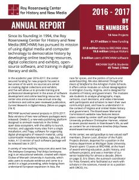

---
authors:
- "Stephen Robertson"
categories:
- News
date: '2017-10-19T15:14:15Z'
draft: true
featured_image: RRCHNM-Annual-Report_2016-17.jpg
slug: annual-report-2016-2017
title: Annual Report 2016-2017
---

 Our second short annual report has recently been mailed out to RRCHNM's friends and supporters. Produced in collaboration with the Development Office of College of Humanities and Social Sciences, the annual report describes project launches and grants for new projects in the academic year 2016-2016. In it you can find brief descriptions of five of those new projects, and of a busy year of teaching, training, and professional development.  A report on the Center’s endowment completes the document.
A copy can be downloaded [here](RRCHNM-Annual-Report_2016-17.pdf).
