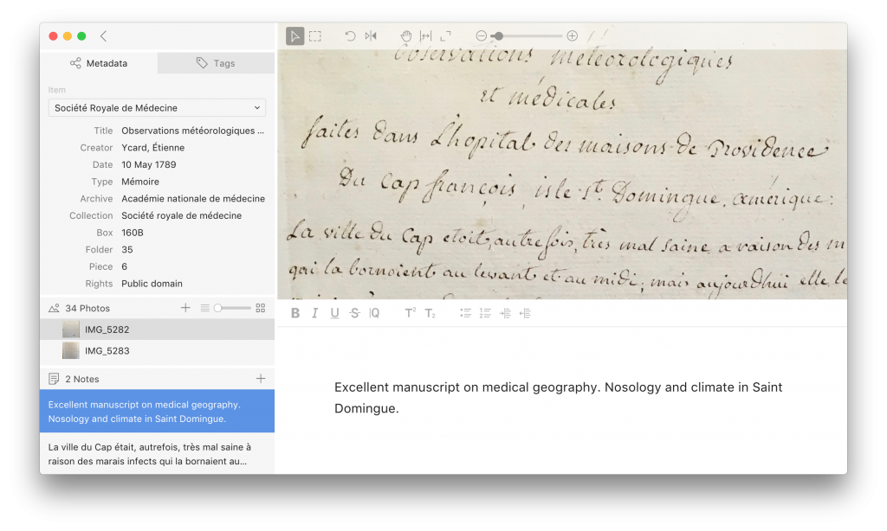

---
authors:
- "Stephen Robertson"
categories:
- News
date: '2017-10-24T13:04:17Z'
draft: true
featured_image: tropy-sticker.jpg
lastmod: '2017-10-24T13:07:06Z'
slug: tropy-1-0-release
title: Tropy 1.0 Release
---

The Roy Rosenzweig Center for History and New Media is pleased to announce the launch of [Tropy version 1.0](https://tropy.org). Tropy is the software that researchers have long-needed to organize and describe the large numbers of photographs they take in archives and libraries of their sources. Tropy is [free and open source,](https://github.com/tropy/tropy) and available for Windows, macOS, and Linux.
Just some of the features Tropy offers:

- Attach descriptive metadata -- such as title, author, date, archive, collection -- to your photos individually or in bulk, using customizable templates
- Organize your photos using tags or lists
- Merge multiple photos into a single item, to group photos of your multi-page sources
- Manipulate your photos so you can read them more easily
- Attach notes or transcriptions to your photos, or to a selection from a photo
- Create templates that include the information you need to know about your sources
- Search the descriptive metadata, tags, and notes to find the sources you need
- Export your items in JSON-LD


Visit Tropy's extensive [documentation](https://docs.tropy.org) to learn how to use the software to describe your research. And please feel free to post questions, problems, and feedback to Tropy's [support forums](https://forums.tropy.org).
Our thanks to Tropy's awesome development team: 

- Sylvester Keil, lead developer
- Johannes Krtek, product designer
- Kirill Stytsenko, developer
- Abby Mullen, project manager
- Jim Safley, metadata consultant

And special thanks to the [Andrew W. Mellon Foundation](https://mellon.org) for funding this project, to our partner institutions for offering feedback, and to our beta users for testing Tropy throughout its development.
