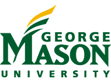
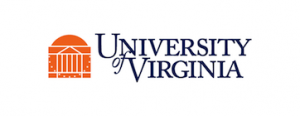
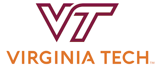
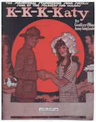

The Roy Rosenzweig Center for History and New Media (RRCHNM) received a [4-VA Research Grant](http://4-va.org) to fund the digital project, **ReSounding the Archives**.
**ReSounding the Archives** is an interdisciplinary collaboration that brings together digital humanities, history, and music. Partners include:

- [RRCHNM](https://rrchnm.org) and the College for the Visual and Performing Arts ([CVPA](https://cvpa.gmu.edu)) at George Mason University ([Mason](https://www2.gmu.edu/));
- [McIntire Department of Music](http://music.virginia.edu/) and [Music Library](http://music.virginia.edu/library) at the University of Virginia ([UVA](http://www.virginia.edu/)); and
- [History](https://liberalarts.vt.edu/departments-and-schools/department-of-history.html) and [English](https://liberalarts.vt.edu/departments-and-schools/department-of-english.html) Departments, [School of Performing Arts](http://www.performingarts.vt.edu/study-with-us/music), and [Special Collections](https://spec.lib.vt.edu/) at Virginia Tech ([VT](https://vt.edu/)).

  
 
The project's goal is literally to "re-sound" the archives — to bring World War I sheet music to life through recordings and live performances. Students from Mason, UVA, and VT will work together to select, research, and record music, exploring history from new vantage points. The project website will provide digitized sheet music, historical context, and usable recordings of each song.
Contemporary students live very musical lives. Allowing professors to integrate historical sheet music into their undergraduate and graduate courses via audio recordings will provide a way for students to historicize that experience and deeply engage historical resources through lyrics, artwork, and the songs themselves to better understand their social, cultural, and political uses. By making the recordings freely available, **ReSounding the Archives** also addresses the lack of historical music available for classroom use.
During spring 2018, students in Dr. Elizabeth Ozment's "ReSounding the Archives" course at UVA, working with librarians Abigail Flanigan and Winston Barham, will select and research WWI-era sheet music. Students in the English and History departments at VT, led by Trudy Harrington Becker, Tom Ewing, and Mark Barrow of the History department, Jim Dubinsky of the English department, and Marc Brodsky of Special Collections, will also select and research sheet music. Music students at Mason and VT will work with student sound engineers to create studio recordings of each piece. Performances and song recording will be organized by Nicole Springer, Assistant Dean for Academic Affairs and Assistant Director, Arts Management Undergraduate Studies, and Linda Monson, Director of Mason's School of Music and Distinguished Service Professor, in Mason's CVPA, along with Tracy Cowden, Michael Dunston, and Brian Thorsett in the music department at VT.
On April 24, 2018, UVA will host a concert and symposium in Charlottesville for partners from all three institutions to showcase student work as well as create live musical performances that will be recorded and added to the website.
RRCHNM, led by Dr. Kelly Schrum, Associate Professor of Higher Education, and Jessica Dauterive, Digital History Fellow, are coordinating the 4VA collaboration and will build and populate the website.
This 4-VA grant will enable students, faculty, and staff to establish relationships across Virginia institutions, leading to new course development as well as opportunities for student work, research, and external funding to expand the project.
