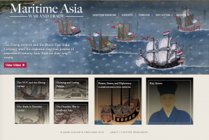

RRCHNM is excited to announce the launch of [*Maritime Asia: War and Trade*](https://maritime-asia.org/), an international collaboration with Adam Clulow at Monash University/University of Texas at Austin and Xing Hang at Brandeis University. This digital world history project explores the fierce rivalry between the Dutch East India Company and the Zheng maritime network as they fought for control over key trades and sea routes. 
https://www.youtube.com/watch?v=cYkKDaKN-kQ&feature=youtu.be
The project includes digital exhibits on these maritime powers, the deerskin trade and territorial claims to Taiwan, as well as a timeline, biographies of key actors, an archive with primary sources, and an annotated bibliography for further exploration. [*Maritime Asia*](https://maritime-asia.org/) also features an exciting classroom simulation exercise, “Pirates, States, and Diplomacy in a Multipolar Maritime Asia” for advanced high school and college students. This is designed to place students at the center of a turbulent maritime world in which a range of territorial powers and armed trading enterprises competed for control over key sea lanes. It explores issue of statehood, political legitimacy, trade and identity. 
[caption id="attachment\_6254" align="aligncenter" width="800"] Homepage of Maritime Asia: War and Trade[/caption]
[*Maritime Asia: War and Trade*](https://maritime-asia.org/) enriches our understanding of early modern East and Southeast Asian history and how trade, colonization, and armed maritime enterprises influenced world history.
