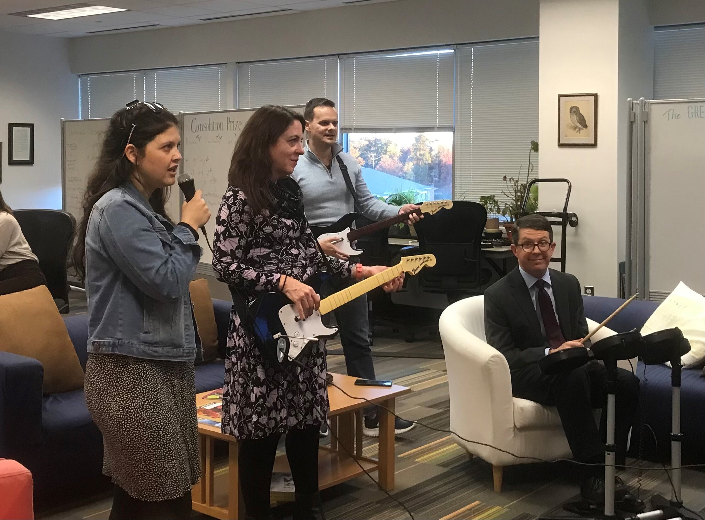
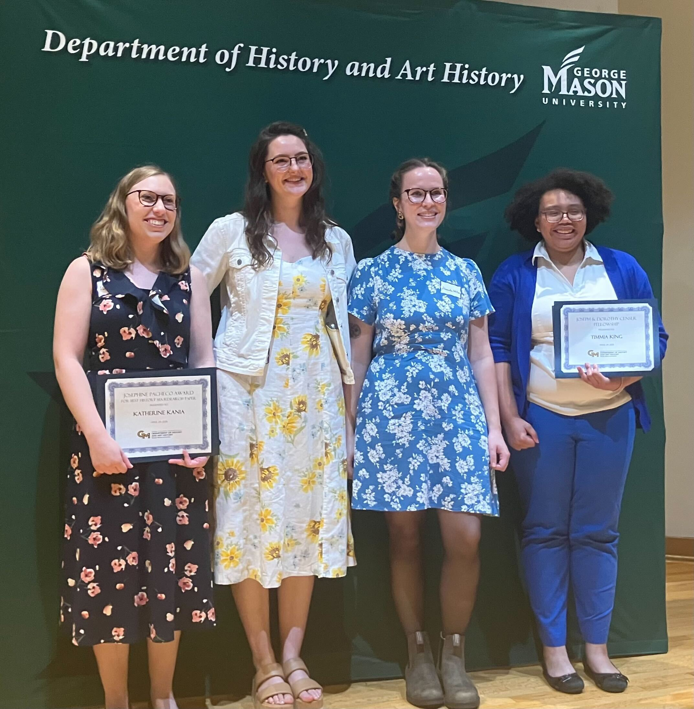
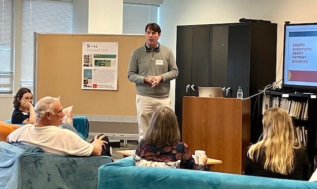
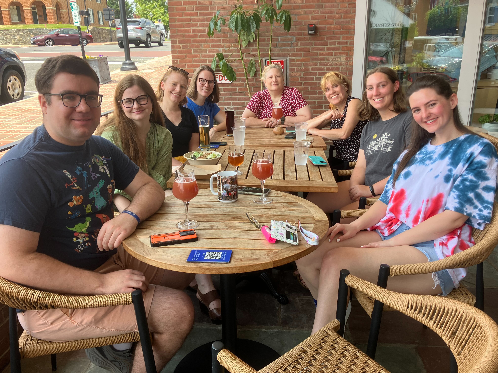
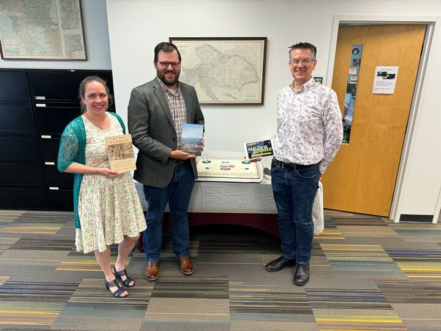
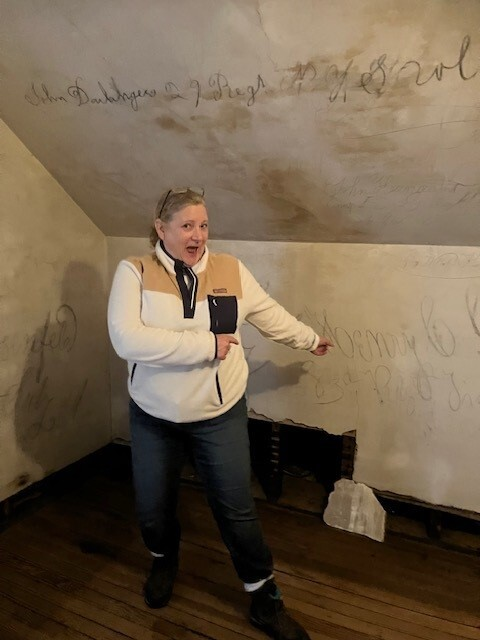

---
aliases:
- /annual-report/
- /contact-us/
- /supporters/
date: '2022-03-21T11:24:51Z'
draft: false
full_width: true
lastmod: '2022-07-22T15:37:32Z'
layout: our-story
slug: our-story
title: Our Story
type: page
url: /our-story/
hero_image: /media/pages/our-story-hero.jpeg
hero_text: Our team includes faculty, developers, technologists, graduate students and undergraduates, support staff, and postdocs. Drawing on many different skillsets, we all practice the discipline of history. 
hero_button_text: 
hero_button_url: 
---



At the Roy Rosenzweig Center for History and New Media we use digital media and computer technology to democratize history: to incorporate multiple voices, reach diverse audiences, and encourage popular participation in presenting and preserving the past.

We are a research center that is a part of the [Department of History and Art History](https://historyarthistory.gmu.edu) at George Mason University. 

RRCHNM has fulfilled our mission in many ways over the past three decades. The work we create is always free and open, because knowledge about the past is a public good. Currently we are focusing on these areas of research:

- We create K–12 educational materials for U.S. and world history.
- We create narrative and public histories.
- We create data-driven histories.
- We train the next generation of digital historians through our PhD program, certificate in digital public history, and other graduate degrees.

### Our History

RRCHNM was founded by the visionary historian [Roy Rosenzweig](https://en.wikipedia.org/wiki/Roy_Rosenzweig) (1950–2007). Rosenzweig was a labor historian and social historian who recognized early on the power of digital media, and especially of the World Wide Web, to democratize history. He founded the Center for History and New Media at George Mason University in 1994. Under his direction, the center created early digital history projects including  the CD-ROM edition of _Who Built America?_ (1993 and 1995, in partnership with the American Social History Project), _Liberty, Equality, Fraternity_ (1997), and _History Matters_ (1998). Rosenzweig also wrote widely about digital history, including in books such as _The Presence of the Past_ (1998, with David Thelen), _Digital History_ (2006, with Dan Cohen), and the essays collected in _Clio Wired_ (2011).



An inveterate collaborator, Rosenzweig had a vision for digital history that led to the creation of CHNM, but also to the broader acceptance of digital history and digital humanities. In time, many centers for digital scholarship would spring up at universities and colleges across the United States and the world. However, CHNM was—and remains—practically unique for being housed within the Department of History and Art History instead of a library or other institution, and it retains its focus on history rather than the humanities writ large. 



And in time, CHNM came to bear its founder’s name. In 2007, Rosenzweig died at the age of 57. Many donors gave generously to an endowment for the center already established in partnership with the National Endowment for the Humanities. We are now proud to be known as the Roy Rosenzweig Center for History and New Media.

Over the past three decades, our work has taken many different forms.

- We have created teaching resources used by millions of teachers and schoolchildren. The legacy of projects such as _History Matters_ and _Historical Thinking Matters_ continues with our teaching websites, *teachinghistory.org* and *World History Commons*. 
- We have collected and preserved primary sources from major events, most notably with the *Hurricane Digital Memory Bank* and the *September 11th Digital Archive*.
- We were an early creator of podcasts with the long-running *Digital Campus* talk show, and later we created a series of scripted narrative podcasts. 
- We created key software for researchers, including Zotero, Omeka, Tropy, DataScribe, and PressForward. This software is now developed by our former colleagues at [Digital Scholar](https://digitalscholar.org/). 

Today RRCHNM continues to be focused on educational resources and public history, while adding an emphasis on data-driven and spatial histories. One cannot be like Roy Rosenzweig by imitating him, because Rosenzweig was not an imitator. We seek to carry on the legacy of our founder by creating meaningful histories in the media that are new in our time.

  
  
  
  
  
  



